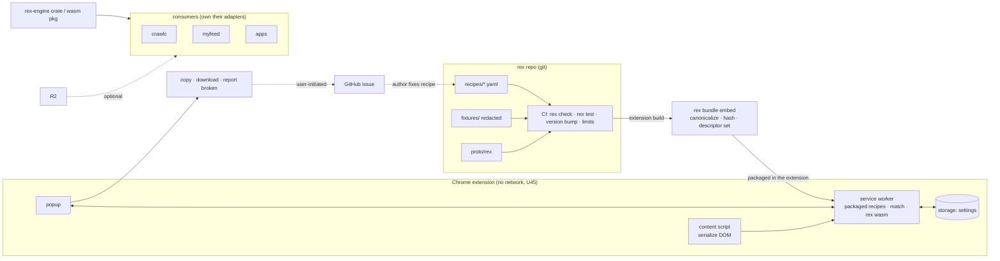
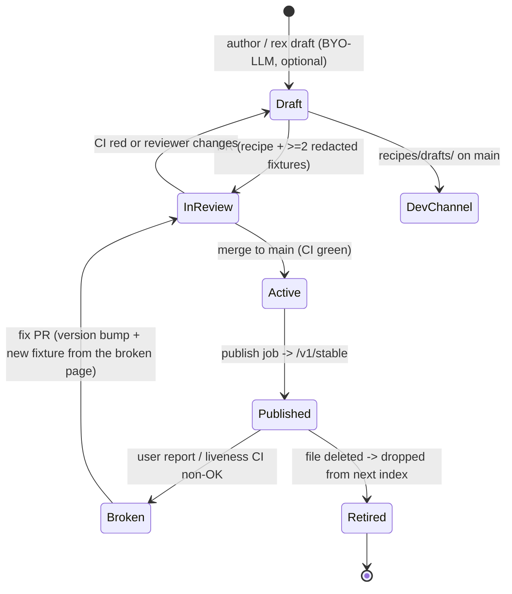

<!-- agent-updated: 2026-10-13T06:00:00Z -->

# rex: system design

| | |
|---|---|
| Status | Complete design, v1. Consistent with [decisions.md](decisions.md) U1–U21 (U1–U5 agreed with the user; U6–U21 delegated, reopenable). |
| Date | 2026-10-12 |
| Contracts | [`proto/rex/`](../proto/rex/): schema annotations, `article.v1`, `feed.v1`, `Extraction`, `ExtractionRecipe`, bundle |
| Engine spec | [designs/261012-generic-recipe-extractor.md](designs/261012-generic-recipe-extractor.md) (normative §8, §10.3, §13) |
| Product | [prd.md](prd.md), [requirements.md](requirements.md) |

## 1. What rex is

rex turns a web page into **one typed, schema-conformant JSON record** using declarative, remotely
updatable **recipes**. It is an independent project with five parts:

| Part | What it is |
|---|---|
| **Contracts** | Proto schemas (`rex.schema.*`), the recipe language (`rex.extract.v1.ExtractionRecipe`), the output envelope (`rex.extract.v1.Extraction`), and the publishing format (`rex.bundle.v1`). |
| **Engine** | A deterministic Rust library: native, as a CLI, and as wasm. It is the only implementation of extraction semantics. |
| **Recipe repository** | Recipes and redacted fixtures in git. A pull request is the review gate, and CI is the quality gate. |
| **Publishing** | A signed, content-addressed static bundle on Cloudflare R2. Any static host works. |
| **Browser extension** | "rex: Page to JSON" (Chrome MV3). Click once to get the current page as an `Extraction`. Recipes update without a release. |

Other systems (crawlc, myfeed, any app) are **consumers**: they embed the engine or read the bundle
(U14, U21).

## 2. Architecture



The data flow has three properties:

- **One way.** Page content never leaves the browser unless the user exports it.
- **Pure fetch.** The extension only *fetches* public, signed data, so the server never learns which
  pages are read.
- **One engine.** CI, the CLI, the extension, and consumers all execute the same engine version.

## 3. Repository layout (monorepo)

```
rex/
  proto/rex/                 contracts (normative)
    schema/v1/annotations.proto
    schema/article/v1/article.proto
    schema/feed/v1/feed.proto
    extract/v1/extraction.proto
    extract/v1/extraction_recipe.proto
    bundle/v1/bundle.proto
  crates/                    Rust workspace (engine spec §10.1)
    rex-proto rex-schema rex-dom rex-readability rex-engine rex-cli     (built in M1)
    rex-wasm · rex-bundle                                                (built, vertical slice)
    rex-redact (M3)                                                      (planned)
  conformance/<case>/        engine-level cases with a case-local recipe.yaml (§8 semantics, statuses)
  extension/                 Chrome MV3 app: TypeScript + esbuild (U24), src/, static/, tests/e2e.mjs
  scripts/build-extension.sh wasm build + wasm-bindgen + extension build
  recipes/
    generic/                 base recipes, one per schema (generic/article.v1, ...)
    sites/<host>/<name>.yaml site recipes
    drafts/                  dev channel only
  fixtures/<recipe-id>/<case>/{page.html, meta.json, expected.json}   redacted (U19)
  fixtures-private/          gitignored, unredacted local captures
  liveness.yaml              recipes eligible for scheduled public liveness checks (U20)
  docs/
  .github/workflows/         ci.yml, publish.yml, liveness.yml, extension.yml
```

## 4. Contracts (summary)

| Contract | Role | Key rules |
|---|---|---|
| `rex.schema.v1` annotations | Turn a proto message into a schema | `kind`, `schema_org`, `required`, `primary`, `max_items`, and enum `schema_org`. No `map<>`. |
| `rex.schema.article.v1.Article` | First schema | Typed article fields, `repeated Person authors`, `primary = body_text`. |
| `rex.schema.feed.v1.Feed` | Listing pages | `items[]` of `{id, title, url, preview, published_at, author, score, comment_count}`. |
| `rex.extract.v1.ExtractionRecipe` | How one page type maps onto one schema | Candidates plus a closed transform set, `extends`, `expect`, `each`, two-stage `match`. |
| `rex.extract.v1.Extraction` | Output envelope | Status, provenance, `Any record`, host fields (`fetch_time`, `source_id`, …). |
| `rex.bundle.v1` | Publishing | `SignedIndex{Ed25519 over payload}`, `Index{channel, sequence, schemas, entries}`. |

Evolution:

- additive changes stay within a package;
- breaking changes create a new package (`rex.schema.article.v2`, `rex.extract.v2`, `/v2/` bundles);
- new engine capabilities are gated by `requires` feature flags.

## 5. Engine (summary)

See the engine spec for the details. Its properties:

- pure and deterministic: an injected clock, no I/O, byte-identical native and wasm output;
- bounded by fuel and limits;
- one parse per page, with lazy and memoized sources;
- schema-driven coercion, where schema.org bindings make `json_ld: {}` work for any schema.

Public API:

| API | Purpose |
|---|---|
| `Registry::from_descriptor_set` | Load schemas |
| `RecipeSet::add` / `compile` | Load base recipes, compile a site recipe |
| `Document::parse` | Parse a page once |
| `CompiledRecipe::extract` | Produce an `Extraction` |
| `match_urls` / `match_page` | Run U2 |

## 6. Recipe lifecycle



CI gates on every PR (U17):

1. `rex check`: strict proto parse, path resolution, cardinality, `each` rules, field-reference DAG,
   `extends` chain, RE2 subset, selector and limit bounds, and `match.urls` present on site recipes.
2. `rex test`: every site recipe has at least 2 fixture cases, and the extraction matches
   `expected.json` byte for byte (excluding the host time fields). `generic/*` recipes have their own
   fixture set (pages without a site recipe).
3. A content change requires a version bump: if the canonical recipe sha256 changes, `version` must
   increase by exactly 1.
4. Cross-recipe checks: no two active recipes have identical `urls` and `page` with equal `priority`
   (a guaranteed tie), and every `extends` target exists.
5. Engine compatibility: all recipes pass on the engine version pinned in `Cargo.lock`. Engine PRs
   rerun every fixture, so a behavior change shows up as fixture diffs reviewed in the same PR.

## 7. Authoring toolchain

### 7.1 CLI

| Command | Purpose |
|---|---|
| `rex check recipes/…` | Contract and semantic validation |
| `rex extract --recipe r.yaml --html page.html --url U [--hints h.json]` | Print the `Extraction` (protojson) |
| `rex explain …` | Per-field trace: each candidate's raw value, what each transform did, the coercion result, why it missed |
| `rex test [ids…]` | Run fixtures; `--update` rewrites `expected.json` (the diff is reviewed in the PR) |
| `rex match <url> [--html f]` | Run the two-stage match against the local recipe set |
| `rex fixture capture <url> --id <recipe> --case <name>` | Fetch over plain HTTP and save to `fixtures-private/` (login-gated pages come from the extension instead) |
| `rex fixture redact <from> <to>` | Redact (U19) into `fixtures/` |
| `rex fixture import <file.rexfixture.json>` | Add a fixture saved by the extension's developer mode (re-linted) |
| `rex fixture lint [roots]` | Fail on unredacted prose in non-synthetic fixtures |
| `rex fmt <file> [--json]` | Canonical form (protojson with `--json`, e.g. for the extension's local recipe) |
| `rex readability --html f --url U` | Run only the readability source |
| `rex liveness [--report r.json]` | Check the live pages in `liveness.yaml` (U20) |
| `rex draft --from <fixture> --schema <msg> --llm <endpoint>` | Optional BYO-LLM drafting into `recipes/drafts/` (U28) |
| `rex bundle keygen/build/verify [--url]` | Keys, local bundles, and client-side verification of a published channel |
| `rex bundle publish/gc --to s3://bucket/prefix` | Publish a channel to an S3-compatible host or a directory, and garbage-collect it (U26) |

### 7.2 The LLM-assisted draft (optional)

`rex draft` builds an evidence pack from the fixture:

- a skeletonized DOM (tags, classes, ids, and a short text sample);
- JSON-LD, meta tags, and candidate repeating structures;
- the target schema's descriptor, including its `schema_org` bindings.

It sends the pack to a user-configured endpoint (temperature 0): either OpenAI-compatible chat
completions or Gemini `generateContent`. The annotated `extraction_recipe.proto` is in the prompt as the
format specification (U28). It parses the result strictly, with up to 2 retries for
structural errors only, and writes it to `recipes/drafts/`.

It never activates anything. The draft must pass `rex test` and be reviewed like any other recipe.
The pipeline has no self-repair loop.

### 7.3 Extension developer mode

- **Local recipe:** paste or load an unsigned recipe. It takes precedence for its match and is labeled
  "dev, unsigned".
- **`explain` trace:** a per-field panel.
- **"Save as fixture":** runs the U19 redaction in the extension (rex wasm), lints it, and downloads one
  `*.rexfixture.json`. `rex fixture import` turns it into `page.html` + `meta.json`, and
  `rex test --update` produces the reviewed `expected.json` (U27). This is the main way to get fixtures
  for login-gated or JS-rendered pages.
- **Dev channel:** the channel is a per-source setting, so a `dev` source sits next to `stable`.

## 8. Publishing and hosting

### 8.1 Publish job (`publish.yml`, on push to `main`)

1. Collect the active recipes (`recipes/generic`, `recipes/sites`) for `stable`; add `recipes/drafts`
   for `dev`.
2. Canonicalize each recipe to protojson (sorted keys, no insignificant whitespace), then hash it with
   sha256 to get `r/<sha256>.json`.
3. Build a `FileDescriptorSet` of every referenced schema plus the annotations, then hash it to get
   `s/<sha256>.fds`.
4. Read the live `index.json` and verify it. The new `sequence` is the old one plus 1.
5. Build the `Index`: entries carry `ref`, `schema`, `extends`, `urls`, `priority`, `requires`,
   `bytes`, and `base`. Sign the canonical payload with Ed25519 (the key comes from the
   `REX_SIGNING_KEY` secret, in a protected environment that requires approval).
6. Upload `r/` and `s/` with `Cache-Control: public, max-age=31536000, immutable`, then upload
   `index.json` with `max-age=300`.
7. Verify the publish end to end: `rex bundle verify --url https://…/v1/<channel>/` as a client would.
8. GC (weekly): delete `r/` and `s/` objects that the live index has not referenced for 30 days.

Implemented by `rex bundle publish` and `rex bundle gc` (U26); setup and rotation are in
[operations.md](operations.md).

### 8.2 Hosting

- **Default:** a Cloudflare R2 bucket behind a custom domain `recipes.<domain>`, serving plain static
  objects. R2 custom domains provide `ETag` and conditional GETs. No Worker is needed.
- **Mirrors:** GitHub Pages or any static server. Clients configure a base URL plus pinned keys
  (`RecipeSource`).

### 8.3 Keys

- Two key slots are pinned in each client release (`active`, `next`).
- **Rotation:** ship a client release with the new key in `next`, wait until adoption exceeds 95%,
  then sign with `next` and move it to `active` in the following release.
- **Compromise:** publish a revocation by shipping a client release that removes the key. The
  anti-rollback `sequence` limits the replay window.

## 9. Browser extension

### 9.1 Components

| Component | Responsibility |
|---|---|
| Service worker | The packaged recipes (`recipes/` in the package), settings, the rex wasm instance, a `CompiledRecipe` cache, matching, extraction, generating `declarativeContent` rules |
| Content script (injected on click) | Returns `{html: doctype + outerHTML (+ serializable shadow roots when supported), url}`. Nothing else. |
| Popup | Shows the result (record preview, status, alternatives), copy and download, "Report broken recipe" |
| Options page | What the packaged recipes are (count, build date, skipped entries), developer mode, output format |

### 9.2 Click flow

1. The user clicks the action. `activeTab` grants the tab.
2. The service worker runs the URL stage of U2 against the stored index. This is local and needs no
   DOM.
3. `scripting.executeScript` runs the packaged serializer, which returns the HTML.
4. rex parses the page once. For each candidate it runs the page stage (`match_page`), then ranks the
   confirmed candidates. If none is confirmed, it uses the schema.org fallback to pick a generic
   recipe. If even that fails, the popup asks which schema to try.
5. The service worker loads `CompiledRecipe`s (compiled once per sha256 and cached), then calls
   `extract` with `now = Date.now()`.
6. The popup renders the result:
   - the record as a typed preview: title, key fields, list counts;
   - a status badge;
   - per-field origin chips;
   - other confirmed candidates, switchable;
   - actions: copy JSON (the `Extraction`, or the record only), download
     `<recipe-id>-<yyyyMMdd-HHmmss>.json`, and "Report broken recipe" on a non-OK status.

### 9.3 Packaged recipes (U45; replaces the bundle sync of U16/U26/U27)

The extension never connects to the internet. The build runs `rex bundle embed`, which writes
`recipes/index.json` (the bundle Index, unsigned: Chrome verifies the package), `recipes/schemas.fds` and
`recipes/recipes.json` (the canonical recipes, in index order) into the package. It embeds
`recipes/generic`, `recipes/sites` and `recipes/auto`; drafts are left out.

1. The service worker reads the three files from the package once (`chrome.runtime.getURL`).
2. It skips entries whose `requires` the engine lacks, and everything extending them, each with a reason.
3. It compiles the rest into one engine, with the developer-mode local recipe merged in when it compiles.
4. On install, update and browser start it regenerates the `declarativeContent` rules from `urls` (the icon
   state for supported pages).

New or fixed recipes reach users with a new extension version.

### 9.4 Permissions and manifest

```json
{
  "manifest_version": 3,
  "name": "rex: Page to JSON",
  "minimum_chrome_version": "137",
  "permissions": ["activeTab", "scripting", "storage", "declarativeContent"],
  "background": { "service_worker": "background.js", "type": "module" },
  "action": { "default_popup": "popup.html" },
  "options_page": "options.html",
  "content_security_policy": { "extension_pages": "script-src 'self' 'wasm-unsafe-eval'; object-src 'self'; img-src 'self' data:; media-src 'none'; font-src 'self'; frame-src 'none'; connect-src 'self'" },
  "commands": { "_execute_action": { "suggested_key": { "default": "Alt+Shift+J" } } }
}
```

- There is no `tabs` permission and no host permission at all.
- `connect-src 'self'`: the extension can fetch only its own files. There is no remote content.

### 9.5 UI principles

- The status is always visible. `FAILED_EXPECTATION` reads as "the site may have changed; the fields
  shown came from fallbacks".
- HTML is never rendered unsanitized. The preview uses `body_text`; sanitized HTML is shown only in a
  sandboxed iframe.
- The UI is localized in `en` and `zh`, and is keyboard-navigable.

## 10. Security and privacy

| Threat | Control |
|---|---|
| Malicious or compromised recipe host or CDN | None to compromise: the recipes are in the package, which Chrome verifies (U45) |
| A malicious recipe that passed review | Recipes are inert data: closed sources and transforms, the RE2 subset, fuel and limits, strict parsing (engine spec §13) |
| A hostile page | Extraction runs off-page in the extension's wasm, with spec-compliant parsing and size, node, and depth caps |
| XSS through extracted HTML | ammonia allow-list at extraction; preview text-only or in a sandboxed iframe |
| Leaking browsing | No network requests at all (CSP `connect-src 'self'`, checked in every e2e run), no telemetry, issue reports are user-initiated and include the URL only on opt-in |
| Supply chain (CI signing key) | Signing only in a protected environment requiring approval, a key never present in PR workflows, two key slots for rotation |
| Copyright of fixtures | Redaction before commit (U19); unredacted captures are gitignored |
| Paywalls and ToS | No bypass: the extension reads only what the user's own browser renders, and stores nothing remotely |

## 11. Testing and CI

| Workflow | Runs |
|---|---|
| `ci.yml` (push, PR) | `cargo fmt/clippy/test` (AAA unit tests), `rex check` (≥ 2 fixtures, version-bump gate) + `rex test` + fixture lint, the wasm size budget, conformance under wasm (byte-identical); the extension job runs typecheck, a store build checked for e2e leaks, and both Playwright suites against the unpacked e2e build with a CLI-published, test-signed bundle served by route interception (U29) |
| `publish.yml` (main) | §8.1 |
| `liveness.yml` (daily) | U20: public sample URLs for `liveness.yaml` recipes; on a non-OK status, open or update an issue |
| Nightly | `cargo fuzz` (recipe parse, document parse plus extract, transforms), the readability differential against Mozilla on the private corpus |

## 12. Feedback and drift

There is no telemetry, by design. The two signals are:

1. **User reports.** "Report broken recipe" opens
   `github.com/<owner>/rex/issues/new?template=broken-recipe.yml` with the recipe ref, status, failing
   paths, and versions. The URL is included only on opt-in.
2. **Liveness CI** for public sites.

Fix flow: capture a new fixture from the broken page (developer mode), fix the recipe, bump its
version, and open a PR. CI then proves both the old and the new fixtures pass, or the old fixture is
retired explicitly in the PR.

## 13. Integrations (consumer-owned)

| Consumer | How |
|---|---|
| crawlc / dragbv3 | Embeds `rex-engine` (git dependency at a tag) as its Extractor. Its own translator converts `ExtractionSchema` to `ExtractionRecipe`. It passes `Ctx.hints` from feed and sitemap entries, and sets `source_id` to its raw-object id. It may subscribe to the rex bundle or keep its own registry. |
| myfeed | Replaces its JS listing recipes with `feed.v1` rex recipes, run through the crate or `rex extract` on its CDP-rendered HTML. |
| Web apps and Node | `@rex/engine` (wasm) with the same API. |

## 14. Milestones

| Milestone | Deliverable |
|---|---|
| **M0** | Design complete: contracts, decisions, this document. Repo renamed to `Shuozeli/rex` (done). |
| **M1** ✅ | Engine E1–E3 (DOM, schema registry, compile, the css/meta/link/url/constant/json_ld/microdata/hint sources, transforms, §8 semantics, `each`, `extends`, statuses), `rex check/extract/explain/test/match`, the first conformance set (8 cases) and fixtures (6), `scripts/validate_recipes.py` retired. Done 2026-10-12 (uncommitted at the time of writing). |
| **M2** ✅ | Engine E4–E5: readability port (benchmarked against Mozilla), wasm build within budget (U25), conformance under wasm. |
| **M3** ✅ | Recipe repo: generic recipes, 12 site recipes plus one draft with redacted fixtures, CI gates, `rex fixture`, liveness. |
| **M4** ✅ | Publishing: `rex bundle publish/gc`, `publish.yml`, `/v1/stable` and `/v1/dev`, verified on MinIO. The R2 account, domain and production key are pending (user). |
| **M5** ✅ | Extension **v0.1**: sync, two-stage match, extract, popup, copy and download, report. (Sync replaced by packaged recipes in v0.3, U45.) |
| **M6** ✅ | Extension **v0.2**: options (sources, channel, interval, format), developer mode (local recipe, explain, save as fixture), `declarativeContent` icon state, en/zh. |
| **M7** | `rex draft` (BYO-LLM) ✅; the first consumer integration (myfeed `feed.v1`) and a Chrome Web Store listing decision are pending. |

M2–M7 were implemented on 2026-10-13 and are not committed yet.

## 15. Open questions

1. The Cloudflare account, bucket, and domain. The signing key is generated and owned by the user.
2. Repo visibility: it is private now. Going public implies that fixtures must be redacted, which they
   already are by design.
3. Chrome Web Store: an unlisted listing, or unpacked only, at v0.1?
4. Typed extensions for site-specific data (`repeated Any extensions`): deferred until a concrete need
   appears.
5. Global protobuf extension-number registration before public schemas.
