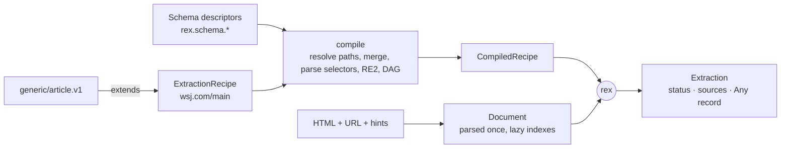

<!-- agent-updated: 2026-10-13T06:00:00Z -->

# rex engine specification (v3)

| | |
|---|---|
| Status | Consistent with [decisions.md](../decisions.md) U1–U21. Normative for value semantics (§8), limits (§10.3), and security (§13); the protos under `proto/rex/` are normative for every contract. |
| Date | 2026-10-12. v1 and v2 are superseded: v1 was the one-pass proposal, v2 assumed the engine lived in crawlc. |
| Home | This repo, `crates/` (U14). |
| Consumers | rex CLI and CI, the rex browser extension (wasm), and optional third parties such as crawlc and myfeed, which own their own adapters (U21). |

## 1. Summary

```
(HTML, page URL, hints, ExtractionRecipe(+bases), schema descriptors) ──► rex ──► rex.extract.v1.Extraction
                                                                                   └ record: Any(rex.schema.*)
```

- **Schemas are proto messages** with `rex.schema.v1` annotations: kind, schema.org binding, and
  required/primary (U1, U3). The first two are `article.v1` (U5) and `feed.v1` (U9).
- **Recipes are `rex.extract.v1.ExtractionRecipe`.** Each field path has ordered candidates and a
  closed transform pipe, and base recipes (`generic/<schema>`) are `extends`-ed (U6–U8).
- **The output is an `Extraction` envelope** with status, provenance, and `Any record` (U4).
- **One Rust implementation**, native and `wasm32`, with byte-identical output.

## 2. Contract map

| Contract | File |
|---|---|
| Schema annotations | `proto/rex/schema/v1/annotations.proto` |
| Article schema | `proto/rex/schema/article/v1/article.proto` |
| Feed schema | `proto/rex/schema/feed/v1/feed.proto` |
| Extraction envelope, `RecipeRef` | `proto/rex/extract/v1/extraction.proto` |
| Recipe, match, candidates, transforms | `proto/rex/extract/v1/extraction_recipe.proto` |
| Bundle (publishing) | `proto/rex/bundle/v1/bundle.proto` |
| Example recipes | `recipes/generic/article.v1.yaml`, `recipes/sites/<host>/<name>.yaml` |
| Validation | `rex check` (crates/rex-cli) |

## 3. Goals and non-goals

**Goals:**

- Typed, semantic output for any registered schema.
- Drift-robust fallbacks with provenance and an explicit `expect` signal.
- Deterministic and pure: no I/O, an injected clock, byte-identical native and wasm output.
- Bounded cost through fuel and limits.
- One canonical, strictly validated authoring form for humans and LLM-assisted drafting.

**Non-goals:**

- Running JavaScript, rendering, fetching, or paginating across pages (hosts own those).
- XPath in v1.
- Any LLM call inside the engine.
- Mutating the page.

## 4. Concepts



- **The schema registry is a descriptor pool** built from a `FileDescriptorSet`: the bundle's
  `s/<sha256>.fds`, or the descriptors embedded at build time for the CLI. It is read with
  `prost-reflect`. New schemas arrive as data, with no engine release.
- **A Document** is the parsed HTML plus lazily built, memoized indexes: the meta map, JSON-LD nodes
  (`@graph` flattened, `@id` resolved one level), microdata items, and the readability result.

## 5. Schemas (summary; the protos are normative)

| Proto construct | Meaning for extraction |
|---|---|
| `string` with `kind` STRING / TEXT / HTML / URL / DECIMAL / DATE | Coercion per §8 |
| `google.protobuf.Timestamp` | datetime (§8.4) |
| `int64` / `int32` / `double` / `bool` | number (§8.5) / `TAKE_EXISTS` or `map` |
| proto `enum` + `enum_value.schema_org` | JSON-LD values map automatically; otherwise use `map` |
| nested message (`record.schema_org`) | Object. JSON-LD objects coerce field by field; a scalar fills the single required string field |
| `repeated` | List: all matches of the winning candidate, capped by `max_items` |
| `map<>` | **Forbidden** |
| `required` / `primary` | Missing → `INVALID` / all missing → `EMPTY` |

## 6. Recipes (summary; the protos are normative)

```yaml
id: wsj.com/main
version: 1
schema: rex.schema.article.v1.Article
extends: generic/article.v1
root: article
match:
  urls: { hosts: ["wsj.com"], include: ["^/articles/[^/?]+"], exclude: ["/print(\\?|$)"] }
  page: { any: [ { json_ld_type: { types: [NewsArticle, Article] } }, { meta: { key: "og:type", value: article } } ] }
fields:
  - path: title
    candidates: [ { css: { selector: "h1" } } ]
  - path: body_html
    expect: true
    candidates: [ { css: { selector: "section[subscriptions-section=content]", take: TAKE_HTML } } ]
```

- **Merge.** A field's effective candidates are its own candidates (with this recipe's pipe) followed
  by the inherited candidates (with the base's pipe), unless `replace_inherited` is set. Unmentioned
  fields come from the base.
- **`json_ld: {}` and `microdata: {}`** take their types from the record's `schema_org` and their path
  from the field's `schema_org`.
- **Lists of objects:** `each` plus nested rules (DOM), or object coercion (JSON-LD).
- **`css.exclude`** (U22): descendant subtrees removed before a text or HTML value is taken, e.g.
  `exclude: [".ad", "[class*=read-next]"]`.
- **Matching (U2)** is driven by the host, using `match_urls` and `match_page` on the same parse.

## 7. Evaluation semantics

```
compile(recipe, registry, bases):
  resolve schema; resolve extends (≤ 3); merge candidates per field
  every path resolves; `each` only on repeated message fields; nested rules only under `each`
  parse CSS (selectors crate; leading combinator → :scope), compile RE2 (regex crate, size_limit)
  type-check pipes vs field kind; topo-order `field` references (no cycles)
  reject unknown transforms / unsupported `requires`
  → CompiledRecipe (immutable, Send + Sync, cached by recipe sha256)

extract(compiled, document, ctx{ now, hints, limits, host fields }):
  root := recipe.root match (declared but missing → EMPTY); else document
  for field in topo order:
    for cand in merged candidates:                         # lazy
      raw   := source(cand, scope)                         # list for repeated fields
      v     := cand.pipe(raw) |> rule.pipe(·)
      typed := coerce(v, field kind / proto type)          # §8; failure = miss
      if typed non-empty: set; sources += {path, origin, candidate, recipe}; break
      else: diagnostics += (no_match | transform_miss | coerce_failed)
    if rule.expect and the winner is not this recipe's own candidate: expectations_failed += path
    if none won and a `default` exists: set default (origin CONST)
  status := EMPTY if all primary missing
          > INVALID if any required missing or budget exceeded
          > FAILED_EXPECTATION if expectations_failed non-empty
          > OK
  if the primary long text came from a site candidate: force readability →
     body_readability_agreement_bps = token-set Jaccard × 10000
  → Extraction{ recipe, chain, schema, url, host fields, status, …, record: Any(record) }
```

- **Origins:**
  - `css` → `SITE_SELECTOR`;
  - `json_ld` → `JSON_LD`;
  - `microdata` → `MICRODATA`;
  - `meta` with an `og:`/`article:` key → `OPEN_GRAPH`;
  - any other `meta`, and `link` → `META`;
  - `readability` → `READABILITY`;
  - `url` → `URL`;
  - `constant` and `default` → `CONST`;
  - `hint` → `DISCOVERY`;
  - `field` → the referenced field's origin.
- **Determinism:** document order, no hash-map iteration in the output, the injected `now`, and fields
  serialized in field-number order.
- **M1 semantics (U23):** `expect` is not inherited; `default` lives only in rule pipes; invalid `each`
  items are dropped; list provenance covers the parent and item 0.
- **Diagnostics** are returned beside the envelope (`ExtractResult{extraction, diagnostics}`). They are
  not part of the `Extraction` contract, which keeps it stable.

## 8. Normative value semantics

### 8.1 STRING (single line)

Concatenate descendant text nodes in document order, skipping:

- `script`, `style`, `noscript`, `template`, and `svg title`;
- elements with the `hidden` attribute or `aria-hidden="true"`;
- elements with an inline `display:none` or `visibility:hidden` style.

Then apply NFC, collapse whitespace (including NBSP) to single spaces, and trim. Stylesheets are never
evaluated.

### 8.2 TEXT (multi-line)

- Block elements (`p div section article header footer main aside nav h1–h6 ul ol li dl dt dd
  blockquote pre figure figcaption table tr hr`) are separated by `\n\n`.
- `br` becomes `\n`, and `td`/`th` are separated by `\t`.
- `pre` is kept verbatim; elsewhere whitespace collapses as in §8.1.
- No space is inserted at a boundary between CJK characters.
- Outer blank lines are trimmed, and runs of 3 or more newlines collapse to 2.

### 8.3 HTML

`ammonia` with the `article` profile:

- tags: `p br h2–h6 ul ol li blockquote pre code em strong b i u s sub sup a img figure figcaption
  table thead tbody tr th td hr`;
- attributes: `href src alt title colspan rowspan`;
- URLs are made absolute, and only `http`, `https`, and `mailto` are allowed;
- `srcset` is reduced to its largest candidate in `src`.

### 8.4 Datetime (`Timestamp`) and DATE

Built-in formats: RFC 3339/ISO 8601 (date-only becomes local midnight), RFC 2822, and epoch seconds
(10 digits) or milliseconds (13 digits).

The `datetime` transform adds:

- chrono `formats`;
- `tz` (IANA zone for offset-less inputs; the default is UTC);
- `locale` `en`/`zh`, including `2026年10月11日 09:30`;
- `relative` dates (feature `relative_dates`, using `now`).

The output is UTC. DATE is `YYYY-MM-DD`. The tz database is a trimmed `chrono-tz` set.

### 8.5 Numbers

- Locale-aware grouping and decimal separators.
- `k`/`M`/`B` suffixes, and with `cjk_units`, `万`/`亿`.
- Integer fields accept `.0` fractions only; anything else is a miss.
- DECIMAL keeps the normalized decimal string.

### 8.6 URL

Resolve against `<base href>`, falling back to the page URL. Drop the fragment unless `keep_fragment`
is set. Apply `strip_query` globs. Only `http(s)` URLs survive. `generic/article.v1` strips `utm_*`,
`fbclid`, and `gclid` from `canonical_url`.

## 9. Output

The output is `rex.extract.v1.Extraction`, serialized as protojson. `record` is an `Any` that
resolves through the same descriptor pool.

- **Host fields** (`fetch_time`, `extract_time`, `source_id`, `source_ref`, the host part of
  `extractor_version`) are supplied through `Ctx`. The engine has no clock.
- **The extension** shows the record, status, and sources.
- **Consumers** store the envelope however they like.

## 10. Engine architecture

### 10.1 Crates (`crates/` in this repo)

Built in M1:

| Crate | Responsibility |
|---|---|
| `rex-proto` | prost types for `proto/rex`, plus the embedded `FileDescriptorSet` |
| `rex-schema` | Descriptor pool, annotation reader, `RecordSpec`/`FieldSpec`, no-`map<>` validation |
| `rex-dom` | html5ever/scraper parse, read-only `Document`, scoped and relative selectors (`:scope`), §8.1–8.2 walkers (with `exclude`), meta/link/JSON-LD/microdata indexes, `Limits` and `Budget` |
| `rex-readability` | Deterministic main-content scorer (U12 as amended) |
| `rex-engine` | Modules `recipe` (parse, merge, compile), `transform`, `values` (dates, numbers, URLs), `coerce` (incl. ammonia), `eval`, `matching`, `fixtures`; plus the `Engine` API |
| `rex-cli` | The `rex` binary: `check`, `extract`, `explain`, `match`, `test` |

Planned:

| Crate | Milestone | Responsibility |
|---|---|---|
| `rex-wasm` | M2 | wasm-bindgen facade (`@rex/engine`) |
| `rex-bundle` | M4 | Bundle build, sign, verify |
| `rex-redact` | M3 | Fixture redaction (U19) |

### 10.2 Rust API

```rust
let registry = Registry::from_descriptor_set(&fds_bytes)?;
let mut recipes = RecipeSet::new(&registry);
recipes.add(ExtractionRecipe::from_json(generic_article)?)?;        // bases first
let plan = recipes.compile(&ExtractionRecipe::from_json(site)?)?;   // Err(Vec<CompileError{path, msg}>)
let doc = Document::parse(html, page_url, &Limits::default())?;
let res: ExtractResult = plan.extract(&doc, &Ctx { now, hints, host, limits: Limits::default() });
```

### 10.3 Limits and fuel

Fuel is counted per node visit, selector step, regex call, and transform step. Exhausting it gives
`budget_exceeded`, then `INVALID`. Because it counts operations rather than time, it is deterministic.

| Limit | Default |
|---|---|
| Input HTML | 10 MB |
| DOM nodes | 500k |
| Fuel | 50M |
| Items per repeated field | `max_items`, or 1000 by default |
| Nesting depth | 8 |
| Output | 4 MB |
| Selector length | 512 chars |
| Regex compiled size | 1 MB |
| Rules per recipe | 256 |
| `extends` depth | 3 |

## 11. WASM

`@rex/engine` exposes:

```ts
const rex = await Rex.init(wasmBytes);
rex.loadSchemas(fdsBytes);
rex.addRecipe(baseJson);
const plan = rex.compile(recipeJson);                          // throws RexCompileError{ errors: [{path, msg}] }
const urlHits = rex.matchUrls(url);                            // over added recipes
const doc = rex.parse(html, url);
const confirmed = doc.matchPage(urlHits);
const { extraction, diagnostics } = plan.extract(doc, { now: Date.now(), hints: {} });
doc.free(); plan.free();
```

- It runs in the extension service worker under `wasm-unsafe-eval`.
- **Size budget:** ~~≤ 1.5 MB raw, ≤ 600 KB gzipped~~ **≤ 1.15 MB gzipped** (amended, decisions.md U25).
  The levers in use: a trimmed tz set, trimmed regex Unicode tables, one html5ever, and the `wasm` profile
  (`opt-level="s"` plus LTO). `opt-level="z"` was rejected because it runs about 6× slower than native.
  Measured: about 1.06 MB gzipped.
- The wasm API as shipped is `verifyIndex`, `sha256Hex`, `engineVersion`, `supportedFeatures`,
  `redactHtml`, `lintHtml`, `recipeId`, and `RexEngine { new(fds, recipes), recipeIds, matchUrl, extract }`.
  These are JSON-in/JSON-out wrappers over the same crates, rather than the object-handle API sketched
  above.

Performance targets (original) and measurements on a 1.27 MB real page (2026-10-13):

| Case | Target | Measured |
|---|---|---|
| 1 MB page, native | < 60 ms | parse 9 ms; full extraction ~140 ms (readability included) |
| Same, wasm | < 150 ms | ~450 ms in Chrome |
| Readability, when it runs | + < 80 ms | dominates the native time on long pages |
| Peak memory | < 60 MB | 35 MB RSS (CLI, end to end) |

The native and wasm targets are not met on the largest pages. Readability scoring is the hot spot
(`examples/profile_stages.rs`). Users perceive a click-to-result time under 0.5 s on typical pages.

## 12. Integrations (consumer-owned, U21)

rex promises three things to integrators: the contracts, the engine semver, and the bundle format.
Adapters live in the consumer's repo, for example:

- **crawlc:** an `ExtractionSchema` → `ExtractionRecipe` translator, `Ctx.hints` from its feed
  entries, `source_id` = its raw id;
- **myfeed:** `feed.v1` recipes instead of JS.

They depend on `rex-engine` through a git dependency pinned to a tag.

## 13. Security

| Risk | Control |
|---|---|
| Hostile or compromised recipe | No code. Closed source and transform sets. RE2-only regex with a size limit. Fuel and limits. Strict proto parsing. A signed bundle (design.md §8, §10). |
| Hostile page | Spec-compliant parsing, node and size caps, JSON-LD depth and size caps, extraction off-page. |
| XSS via HTML output | ammonia allow-list, URL scheme allow-list. Hosts treat output as untrusted. |
| Panics | `panic = "abort"` in wasm. Fuzz targets for recipe parse, document parse plus extract, and transform chains. |

## 14. Testing

| Layer | What |
|---|---|
| Contract | `rex check` on every recipe (it replaced the Python prototype in M1); negative fixtures for compile errors |
| Unit (AAA) | Each source, each transform, the §8 walkers (CJK, RTL, `pre`, hidden elements), coercion into messages, merge, DAG |
| Conformance | `conformance/<case>/{page.html, url, hints.json, recipe.yaml, expected.json}` plus every recipe fixture under `fixtures/`, **natively and under wasm**, byte-identical |
| Fuzz | `cargo fuzz` nightly |
| Corpus | Unredacted local corpus (`fixtures-private/`, the maintainers' own captures), with per-recipe status and populated-rate deltas on engine changes |
| Readability | `rex-readability` vs Mozilla Readability.js on the corpus, token-set Jaccard median ≥ 0.9 |
| Size and performance | CI budget on wasm size, plus criterion regressions over 15% |

## 15. Versioning

| Artifact | Rule |
|---|---|
| Schemas | Proto evolution: additive within a package, a new package for breaking changes |
| `ExtractionRecipe` and `Extraction` | Additive within `rex.extract.v1`. New capabilities arrive through `requires`; an engine missing a feature rejects the recipe at compile time, and the host falls back. |
| Bundle | `rex.bundle.index.v1` under `/v1/`. A breaking change goes to `/v2/`, with `/v1/` kept for old clients. |
| Engine | semver. Output changes for the same input need a minor bump plus reviewed fixture diffs. |

## 16. Alternatives (resolved)

| Alternative | Resolution |
|---|---|
| A fixed Article-only schema | Superseded by U1 |
| Generic key-value output | Rejected (U1) |
| YAML schema language or JSON Schema | Rejected (U1: proto) |
| Wrapper value types | Rejected (U3) |
| A `oneof` of schemas in the envelope | Rejected (U4: `Any`) |
| A TS engine on the live DOM | Rejected (single Rust implementation) |
| An expression language (JSONata/CEL) | Rejected for v1 (U8) |
| Mozilla Readability as a dependency | Rejected (U12) |
| Living inside crawlc | Rejected (U14: independent project) |

## 17. Milestones

The engine milestones E1–E5 map to design.md §14 M1–M2:

| Milestone | Deliverable |
|---|---|
| E1 | `rex-dom`, `rex-schema`, `rex-recipe`, css/meta/link/url/constant, §8.1–8.2, flat fields, `rex check/extract` |
| E2 | `each`, the full transform set, §8.4–8.6, the field-reference DAG, fuel and limits, `feed.v1` + HN |
| E3 | `json_ld`/`microdata` with schema.org defaulting and object coercion, `hint`, `generic/article.v1`, `extends`, `expect`, statuses, `rex explain/test` |
| E4 | `rex-readability`, the agreement metric, the corpus differential |
| E5 | `rex-wasm` (`@rex/engine`), the size budget, conformance under wasm, `match_urls`/`match_page`, `rex-redact` in wasm |

## 18. Remaining open questions

1. Shadow DOM: use `getHTML({ serializableShadowRoots: true })` when available (proposed: yes,
   best-effort).
2. Typed extensions (`repeated Any extensions`): deferred.
3. Global protobuf extension-number registration before public schemas.
