# rex user guide

rex is a Chrome extension that turns the page you are looking at into structured JSON: an article's title,
authors, dates and text; a product's price; a video's channel and duration; a list of search results or
posts; a stock quote. You click the rex icon, and it reads the open page with a **recipe** for that site,
or with schema.org data the page publishes. Everything happens in your browser: the page is not sent
anywhere (see [Privacy](#privacy)).

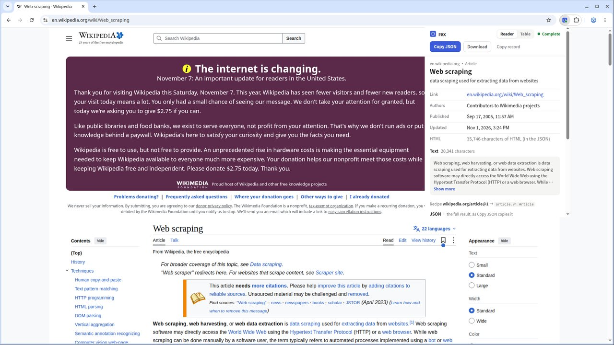

*Screenshots: Google Chrome 156 on Linux, rex 0.3.0 store build (1036 built-in recipes), taken 2026-11-07 with
`extension/recorder/guide.mjs`.*

## Install

**From the Chrome Web Store:** open rex's page in the store and click **Add to Chrome**, then click the
puzzle-piece icon in the toolbar and pin **rex: Page to JSON**. Chrome updates it by itself. (The store page is
linked from the repository's README once it is published; store/README.md describes the listing.)

**From source** (unpacked, for development):

1. `scripts/store-package.sh` builds `target/store/rex-extension-<version>.zip`, or `scripts/build-extension.sh`
   builds `extension/dist/`.
2. Unzip the ZIP into a folder you keep (Chrome loads the extension from it every time).
3. Open `chrome://extensions`, turn on **Developer mode** (top right), click **Load unpacked**, and pick the folder.
4. Pin **rex: Page to JSON** from the puzzle-piece icon.

Requirements:

- **Chrome 137 or newer.**
- Nothing else. The recipes are built into the extension, which never connects to the internet. New recipes
  come with a new version of the extension.

**Updating an unpacked install:** replace the folder's contents with the new build and click the reload arrow
on rex's card in `chrome://extensions`.

## Use it

### The toolbar icon

| A site with its own recipe | Any other site |
|---|---|
| 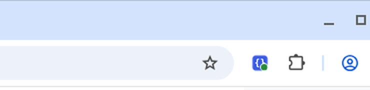 | 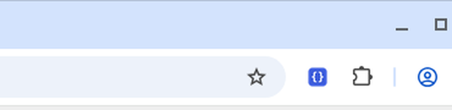 |

- **A green dot** on the rex icon means this site has a recipe of its own, for example Wikipedia, YouTube,
  Amazon, Bilibili or Hacker News. The dev bundle has 1,024 site recipes: 52 reviewed by hand and the rest
  harvested automatically (dev channel only).
- **No dot** does not mean rex is useless there. Many pages publish schema.org data (articles, products,
  recipes, events, jobs…), and rex's generic recipes read it.

Click the icon, or press **Alt+Shift+J**. rex only reads a page when you do this; it has no access to your
tabs otherwise.

### The popup

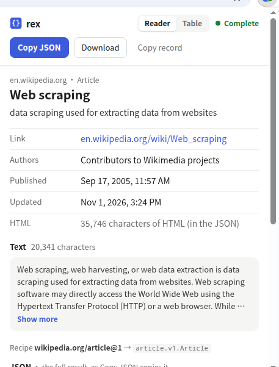

At the top, always in view while the rest scrolls:

- **Reader / Table:** the two views of the result (below). rex remembers your choice.
- **The status**, in words:
  - **● Complete** (green): everything the recipe expects was found.
  - **● Check** (orange) and **● Incomplete** / **● Empty** (red): see [Statuses](#statuses).
- **The buttons:**
  - **Copy JSON** copies the result. What it copies (the full result or the record only) is set in
    [Options](#options).
  - **Download** saves it as a `.json` file.
  - The quiet third button copies the other form (**Copy record** or **Copy envelope**).

Below them is the result. At the bottom, in every view, comes the **JSON**: exactly what Copy JSON copies.

<br clear="right">

#### The Reader view

The record as a card:

- **The heading:** the site and the kind of page (`en.wikipedia.org · Article`), the title, and the summary.
  A quote or a product shows its price here, with the day's change in color. Chinese UI: red up, green down.
- **The facts** in two columns, in plain language:
  - dates such as `Sep 17, 2005, 11:57 AM`;
  - grouped numbers, and large counts shortened (`3.3M` views, `1.8T` market cap);
  - durations: `3:37` for a video, `20 min` for a recipe;
  - kinds in words ("Stock", "In stock", "Open").
- **Long text** is folded to a few lines with **Show more**.
- **Lists** show one entry per item: the linked title, then who, the numbers and when
  (`Rasbora · Score 717 · Comments 227 · 6 hours ago`).

| An article | A quote | A list |
|---|---|---|
|  | 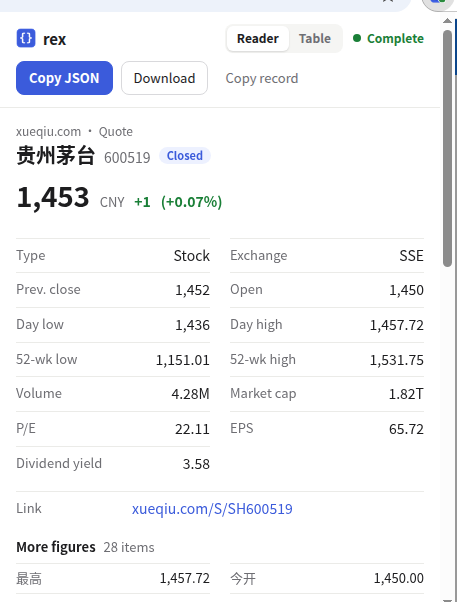 | 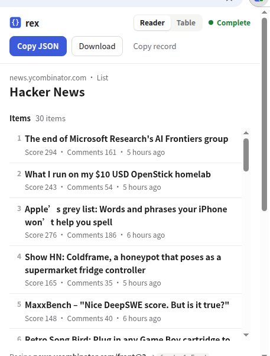 |

#### The Table view

One row per field, as the data is:

- the field's schema name (`published_at`, `market_cap`);
- the exact value: every digit, times in UTC (`2005-09-17 18:57 UTC`);
- a colored **dot** saying where the value came from: the site's recipe, JSON-LD, meta tags, the URL, a recipe
  value… The legend under the table names the colors, and hovering a dot does too.

Use it to check a value precisely or to see what a recipe relies on.

| An article | A quote | A list |
|---|---|---|
| 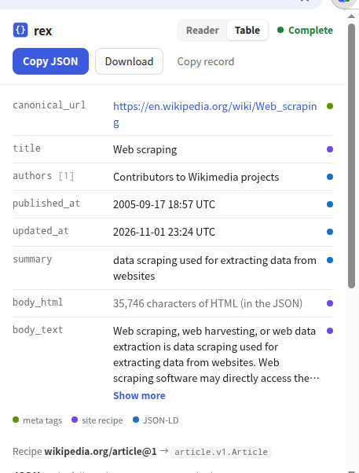 | 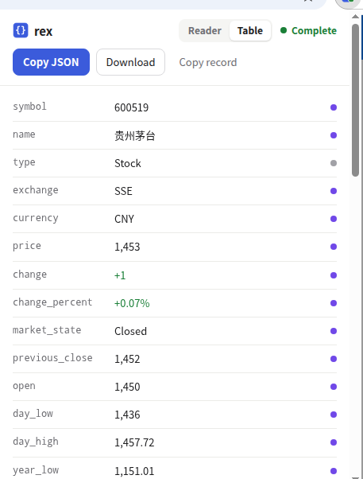 | 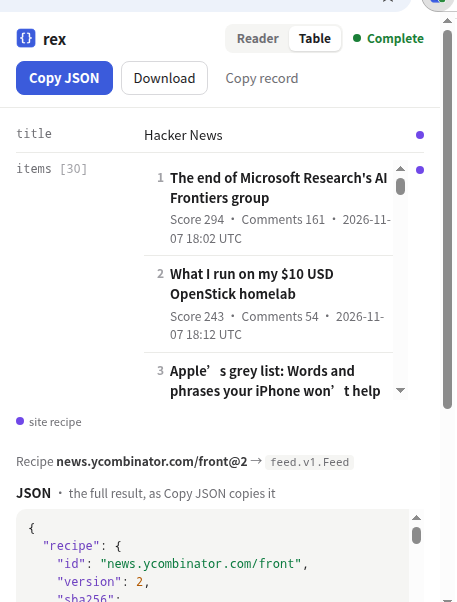 |

#### The JSON

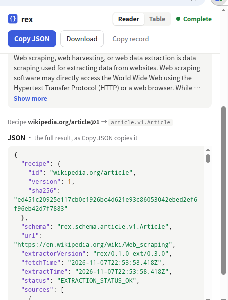

The bottom of the popup always shows the JSON that **Copy JSON** copies, with keys, strings and numbers in
their own colors. The note next to the heading says which form it is.

- **The full result** (the default): the record plus how it was made: the recipe and its version, the record
  type, the page URL, the fetch and extraction times, the status, and for each field where its value came from
  (`sources`).
- **The record only** (set in [Options](#options)): just the data.

<br clear="right">

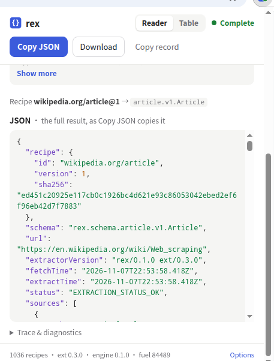

The heading and buttons **stay at the top** while you scroll, right under the icon you clicked.

<br clear="right">

### What you get

The record of the Wikipedia article above (Copy record; long text shortened here):

```json
{
  "canonicalUrl": "https://en.wikipedia.org/wiki/Web_scraping",
  "title": "Web scraping",
  "authors": [{ "name": "Contributors to Wikimedia projects" }],
  "publishedAt": "2005-09-17T18:57:30Z",
  "updatedAt": "2026-11-01T23:24:25Z",
  "summary": "data scraping used for extracting data from websites",
  "bodyHtml": "<p><b>Web scraping</b>, <b>web harvesting</b>, or <b>web data extraction</b> is <a href=\"h…",
  "bodyText": "Web scraping, web harvesting, or web data extraction is data scraping used for extracting …"
}
```

The values are kept as the schema defines them: times in UTC (RFC 3339), large numbers as strings. Only the
popup's views format them for reading.

### More kinds of pages

| A video: Bilibili | No recipe of its own: a cooking site |
|---|---|
| 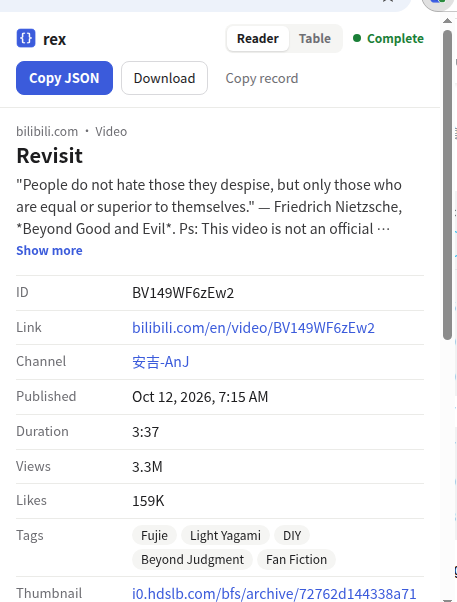 | 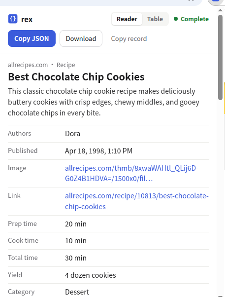 |
| Video id from the URL; title, channel, date, duration, views, likes and tags from the page. | The site has no recipe, but the page publishes a schema.org `Recipe`, so rex's generic recipe reads it: times, yield, ingredients, steps. |

**Sites without a recipe of their own** still work when the page publishes schema.org data. The recipe line
at the bottom then says `generic/recipe.v1@1 (generic, detected Recipe)`.

Generic recipes exist for articles, products, videos, recipes and how-tos, FAQs, events, local businesses,
job postings, apps, films/TV and books, and stock quotes.

When more than one recipe fits a page, the popup shows **Also matches** with a button per recipe, so you can
switch.

### Statuses

| Status | Meaning | What to do |
|---|---|---|
| **● Complete** (green) | Every field the recipe expects was found. | Copy or download. |
| **● Check** (orange) | The recipe found the page but a value it relies on is missing. Typical causes: a paywall teaser instead of the article, or the site changed its layout. A note above the result says which check failed. | If you can see the content, the recipe is probably out of date: use **Report broken recipe**. |
| **● Incomplete** / **● Empty** (red) | A required field is missing, or none of the main fields were found. Often a login wall, a bot check ("verify you are human") or a page that has not finished loading. | Wait for the page to finish, sign in or pass the check, and click the icon again. |
| **● No match** (grey) | No recipe applies: the site has no recipe and the page has no schema.org data rex knows. | Nothing to extract here. |

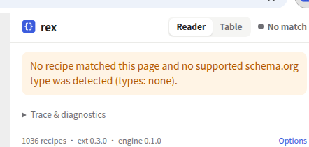

Unless the status is Complete, a **Report broken recipe** button appears. It opens a pre-filled GitHub issue
in a new tab, so you can review it before sending. The page address is included only if you tick
**include page URL in the report**.

### Trace & diagnostics

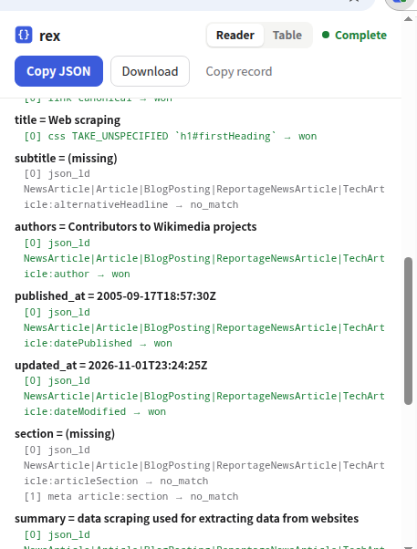

Open **Trace & diagnostics** at the bottom of the popup to see, for each field, the candidates the recipe
tried and which one **won** or found **no_match**. It helps when a value looks wrong or a field is missing.

The footer shows how many recipes are built into this version (here `1036 recipes`) and the extension and
engine versions.

<br clear="right">

## Options

Right-click the rex icon → **Options**, or use the **Options** link in the popup footer.

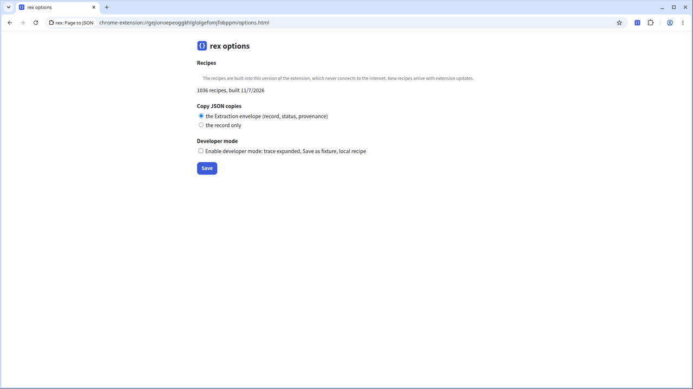

- **Recipes:** how many recipes are built into this version, and when they were built. There is nothing to
  configure: rex never downloads recipes.
- **Copy JSON copies:** the Extraction envelope (the default) or the record only.
- **Developer mode** is for writing recipes. It expands the trace, adds **Save as fixture** (a redacted copy
  of the page for tests), and can run a local, unsigned recipe in place of the built-in one.

## Privacy

- **When rex reads a page:** only when you click its icon (or press the shortcut), and only that tab, through
  Chrome's `activeTab` permission.
- **Where the page goes:** nowhere. The page and the extracted record stay in your browser, and the recipe
  engine runs inside the extension (WebAssembly). Results leave only when you copy or download them.
- **No network at all:** the recipes are inside the extension, and rex asks Chrome for no access to any website.
  Its content security policy lets it connect only to its own files, and blocks images, media, fonts and
  frames from outside the extension. Every test run checks that the extension makes no network request
  (decisions.md U42, U45).
- **Report broken recipe** opens GitHub only when you click it, and includes the page address only if you
  tick the box.

## Troubleshooting

| Problem | Fix |
|---|---|
| The popup says the built-in recipes could not be loaded. | The unzipped folder is incomplete: unzip the download again and reload the extension. |
| A site that used to work now shows **Check**, **Incomplete** or **Empty**. | Reload the page, wait until it has finished, and try again. If you see the content but rex does not, report it. |
| A site shows a login page, a captcha, or "verify you are human". | rex reads only what the page shows. Sign in or pass the check first. |
| The icon does nothing on `chrome://` pages, the Web Store or PDF viewers. | Chrome does not let extensions read those pages. |
| A site changed and rex no longer reads it. | Install the newest version of the extension; recipe fixes arrive with it. Otherwise report it. |

The popup and Options follow Chrome's language: English, or Chinese (简体中文).
